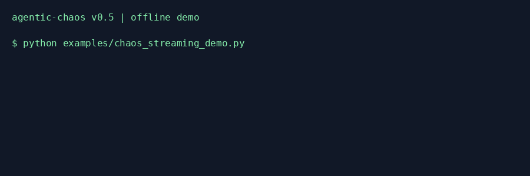

# agentic-chaos

`agentic-chaos` is a standalone fault-injection toolkit for LLM calls and
agentic workflows. It deliberately breaks your app — hung completions,
provider rate-limit storms, silently corrupted output — and reports what
happened. It has **no required dependency on any other package**, including
[AgenticLens](https://github.com/DeepAgentLabs/agenticlens): `pip install
agentic-chaos` and use it against any plain Python callable.

Within the broader DeepAgentLabs architecture, Agentic Chaos is the resilience
and failure-validation reference implementation for the **AI Operations
Workflow Specification**. It injects, validates, tests, and proves resilience,
while keeping its workflow artifacts compatible with the same shared
operational model used by AgenticLens, the MCP layer, and the future
Control Tower control plane.

If you also use AgenticLens, an optional integration lets you merge chaos
events straight into an AgenticLens `Workflow`, so `agenticlens analyze`
reports on cost/latency and chaos impact together — see
[Optional: AgenticLens Integration](#optional-agenticlens-integration) below.
Neither package imports the other at the core level; the two are independent
tools that happen to compose.

## Status

`agentic-chaos` is early-stage software. The **LLM Chaos Toolkit** (v0.1),
**Agent Failure Injector** (v0.2), **Fidelity Judges & Handoff Chaos**
(`v0.3.0`), **Prompt/Model Drift Detector** (`v0.4.0`), and
**Streaming Faults, Provider Patching & Chaos Profiles** (`v0.5.0`),
**Safety Rails** (`0.5.2`) and the **Pytest Plugin & Contracts** (`0.6.0`)
are available.
See [ROADMAP.md](ROADMAP.md) for the full plan.

### What's Next

- **Fault cascades, adaptive intensity & response poisoning (v0.7)** —
  chained failures, breaking-point search and adversarial output
- **Structured experiment reports** — every chaos run emits a report with
  hypothesis, injection point provenance, observed behavior, and verdict
- **Synthetic test scenarios** — prebuilt known-bad agent behaviors for
  consistent resilience validation

## Installation

```bash
pip install agentic-chaos
```

or, from source with `uv`:

```bash
git clone https://github.com/DeepAgentLabs/agentic-chaos.git
cd agentic-chaos
uv sync --extra dev --frozen
```

That's it — no other package required. (If you want the optional AgenticLens
integration too, see [below](#optional-agenticlens-integration).)

`--frozen` matters here: `pyproject.toml` points the (currently unpublished)
`agenticlens` extra at a sibling checkout via `[tool.uv.sources]`, and `uv
sync` without `--frozen` tries to validate/refresh the *entire* lock — every
extra, including ones you didn't ask for — which fails if that sibling
directory doesn't exist. `--frozen` installs straight from the committed
`uv.lock` instead. Drop it (and check out `agenticlens` as a sibling
directory) only if you're working on the optional integration itself — see
[Development](#development).

## Quickstart

Wrap the calls you want to be fragile with `chaos_call()`:

```python
from agentic_chaos.chaos import chaos_call, TokenTimeoutError

try:
    chunks = chaos_call(retriever.search, user_question, faults=["token_timeout"])
except TokenTimeoutError:
    chunks = []  # no fallback handled it -- this is exactly what we want to find
```

Outside of a `chaos_session(...)`, `chaos_call()` is a transparent pass-through
— `fn(*args, **kwargs)` runs exactly as if `agentic-chaos` weren't there. So
the same instrumented code path is safe to ship; chaos only activates when you
explicitly turn it on.

Run the script under chaos from the CLI, choosing which faults are active
without touching the code:

```bash
uv run agentic-chaos chaos run my_app.py --inject token_timeout,rate_limit_storm --save chaos_run.json
```

```text
                                  Chaos Events
  Step        Fault           Outcome    Message
 ────────────────────────────────────────────────────────────────────────────
  Retriever   token_timeout   errored    call hung for 2.0s then timed out

1 chaos event(s) recorded.

Saved chaos report to chaos_run.json
```

`chaos_run.json` is this package's own standalone report — no other library
needed to produce or read it.

## Fault Types (v0.1)

| Fault | `--inject` name | What it does |
| --- | --- | --- |
| Token timeout | `token_timeout` | Hangs for `hang_seconds` (default 2.0s), then raises `TokenTimeoutError` — simulates a client-side timeout on a hung/slow completion. Pass `mode="delay"` to let the real call complete late instead of erroring. |
| Rate-limit storm | `rate_limit_storm` | Raises `RateLimitStormError` (with a `retry_after` hint) for the first `burst_count` calls (default 3), then passes calls through normally — simulates a provider 429/backoff cascade that eventually clears. |
| Silent degradation | `silent_degradation` | Calls the real function, then corrupts its text content (`.content`/`.text`/a raw string) while preserving latency and token counts. The hardest fault to detect and the highest-value one to catch — nothing in cost/latency telemetry looks wrong. |

Every fault records a `ChaosEvent` (`fault_type`, `outcome`, and — when you
pass `step_id`/`step_name` — the correlation you chose). Use the Python API
to override defaults per fault:

```python
from agentic_chaos.chaos import chaos_session, TokenTimeoutFault, RateLimitStormFault

with chaos_session([TokenTimeoutFault(hang_seconds=5.0), RateLimitStormFault(burst_count=1)]):
    ...
```

When more than one fault is configured for a session, `chaos_call()` requires
you to pass `faults=[...]` at each call site to say which one applies there —
silently picking one for you would be surprising.

Two options worth knowing about that don't show up in the table above (see
[`examples/chaos_advanced_faults_demo.py`](examples/chaos_advanced_faults_demo.py)
for both, runnable):

- `TokenTimeoutFault(mode="delay")` — the call still succeeds, just late,
  instead of raising `TokenTimeoutError`. Recorded outcome is `"delayed"`.
  Useful for testing whether a slow-but-successful call degrades UX on its
  own, separate from outright failure.
- `SilentDegradationFault(degrade_fn=my_fn)` — swap in your own corruption
  logic (`my_fn(result) -> corrupted_result`) instead of the built-in text
  garbler, e.g. to simulate a narrower, more realistic bug than wholesale
  noise.

## CLI Reference

```bash
# Run a script with LLM-level chaos active and print a chaos-events report.
agentic-chaos chaos run my_app.py --inject token_timeout,rate_limit_storm

# Same, saving the resulting standalone report for later inspection.
agentic-chaos chaos run my_app.py --inject silent_degradation --save chaos_run.json

# Run a script with agent-level faults.
agentic-chaos agent run my_agent.py --inject tool_failure,memory_corruption --save report.json

# Run a script with edge-scoped handoff chaos.
agentic-chaos agent run my_agent.py --inject handoff_corruption --save report.json

# Save a drift baseline, then compare a current run against it.
agentic-chaos drift snapshot --name support-agent --save baseline.json --prompt-file prompt.txt --model gpt-5-mini --model-fingerprint fp-a
agentic-chaos drift compare baseline.json --prompt-file prompt.txt --output-file answer.txt --model gpt-5-mini --model-fingerprint fp-b --save drift_report.json

# List all available fault types (v0.1 + v0.3).
agentic-chaos chaos list-faults

# Gate a run on chaos contracts (v0.6); exits 1 unless all pass.
agentic-chaos chaos run my_app.py --inject rate_limit_storm --contract max_retries:3 --contract no_unhandled_error

# Re-check contracts against saved reports, and list the built-ins.
agentic-chaos contracts check chaos_run.json --baseline baseline.json --contract full_topology_traversal
agentic-chaos contracts list

# Run @pytest.mark.chaos tests with faults injected (v0.6).
pytest --chaos
```

`agentic-chaos drift compare` exits with code `2` when drift is detected, so
it can fail a CI job while still writing a JSON report when emission rules
allow it.

## Pytest Plugin & Contracts (v0.6.0)

Make chaos part of the normal test run. Mark a test, then run pytest with
`--chaos`; without the flag the marker does nothing and the test runs as usual.

```python
import pytest
from agentic_chaos.contracts import MaxRetries, NoRetryStorm

@pytest.mark.chaos(faults=["rate_limit_storm"], must_recover=True)
def test_agent_handles_rate_limits():
    result = my_agent("What's the weather?")
    assert result is not None

@pytest.mark.chaos("rate_limit_storm", contracts=[MaxRetries(3), NoRetryStorm(5)])
def test_retry_budget_is_bounded():
    assert my_agent("What's the weather?")
```

```bash
pip install "agentic-chaos[pytest]"
pytest --chaos --chaos-report-dir chaos-reports
```

The plugin ships in this package and registers itself with pytest. A
**contract** is a pass/fail check over the run's `ChaosReport`. If a contract
fails, or cannot be evaluated (`inconclusive`), the test fails. The seven
built-ins:

| Contract | Passes when |
|---|---|
| `CompletesWithin(timeout_s)` | the run finished within the time budget |
| `NoUnhandledError()` | no exception escaped the code under test |
| `MaxRetries(n)` | no step was retried more than `n` times in a row |
| `RecoveredAfterFailure()` | the run completed despite an injected failure (`must_recover=True`) |
| `MaxCostImpact(factor)` | recorded cost, or call count, stayed within `factor` × baseline |
| `NoRetryStorm(max_retries_per_window)` | retries across the **whole topology** stayed under a sliding-window limit |
| `FullTopologyTraversal()` | every node the baseline visited also ran under chaos |

`baseline=True` runs the test once as a dry run first, which gives the
comparative contracts a baseline. The `chaos` fixture exposes the live session
(`chaos.record_cost()`, `chaos.attach_topology()`). Async tests under
pytest-asyncio or anyio are supported.

Contracts also work without pytest, on a live session or on saved JSON:

```python
from agentic_chaos.contracts import NoUnhandledError, MaxRetries, assert_contracts

assert_contracts(session.to_report("weather", error=error), [NoUnhandledError(), MaxRetries(3)])
```

```bash
agentic-chaos chaos run app.py --inject rate_limit_storm --contract max_retries:3 --save chaos.json
agentic-chaos contracts check chaos.json --baseline baseline.json --contract max_cost_impact:2,metric=calls
```

Reports now include a call log (`calls`, `calls_dropped`) and the escaped
`unhandled_error`. Contracts read these from the same native JSON that
AgenticLens, Control Tower and MCP consume. The new fields are additive. See
the [v0.6 guide](docs/v0.6.md) for the marker and option reference, the exact
retry and visit definitions, inconclusive rules and caveats, and the
[GitHub Actions example](examples/github-actions-chaos.yml).


## Streaming, Provider Patches & Profiles (v0.5.0)

```python
from agentic_chaos import StreamCutFault, chaos_session, chaos_stream

with chaos_session([StreamCutFault(after_chunks=2)]) as session:
    print(list(chaos_stream(iter(["Hello", " world", "!"]))))
# ['Hello', ' world']; one degraded event, source closed without reading ahead.
```

New faults: `StreamCutFault`, `StreamHangFault`, `SlowTTFTFault`,
`SlowChunksFault`, `AuthErrorFault`, and `ContextLengthFault`. Every fault
accepts `probability=0.0..1.0` and an optional `seed` for reproducible sampling.
Use `chaos_astream()` for async streams and `chaos_acall()` for async calls.

`patch_openai(client)`, `patch_anthropic(client)`, and `patch_google(client)`
wrap the supported methods of an existing client inside `chaos_session()`;
patches restore automatically on exit. SDKs are optional. Install individual
SDKs or `pip install agentic-chaos[providers]`. Anthropic's high-level
`messages.stream()` helper is outside this patch surface; use `messages.create(stream=True)`.
Simulated auth/context errors use this package's exceptions, not SDK exceptions.

```bash
agentic-chaos chaos run examples/chaos_streaming_demo.py \
  --profile streaming-demo --profile-file examples/chaos.toml --save report.json
```

Profiles also work with `agent run`; choose exactly one of `--inject` and
`--profile`. A profile with multiple faults still requires explicit fault
selection at each call site. Streaming fault selection is sampled once per
stream. Consume and close streams inside the session.

See the [v0.5 guide](docs/v0.5.md) for parameters, provider method coverage,
cancellation behavior, profiles, and sibling compatibility. Native reports
remain compatible with Lens, MCP, and Tower. Since `0.5.1` a report can also be
exported as an AI Operations Specification Run artifact; see
[AIOS Run export](#aios-run-export).



## AIOS Run export

The native `ChaosReport` stays this package's own format. To hand chaos
evidence to tools that speak the
[AI Operations Specification](https://github.com/DeepAgentLabs/ai-operations-spec),
export it as a v0.4-draft `run` artifact:

```bash
agentic-chaos chaos run app.py --inject token_timeout --save-aios run.aios.json
```

```python
from agentic_chaos.export import to_aios_run

artifact = to_aios_run(report, status="completed", workflow_id="support-workflow")
```

| ChaosReport | AIOS v0.4-draft Run |
|---|---|
| the report | `run` (plus one `request` for the experiment) |
| `step_id` / `step_name` on events | `steps`, each `contains`-ed once by the run |
| each chaos event | one occurrence (`model_interaction`, `tool_invocation`, `memory_operation`, or `context`), `observed-in` its step |
| each chaos event | one `reliability_event` evidence object that `signals-on` that occurrence |
| timestamps | `aiops.run.*`, `aiops.<kind>.failed`, `aiops.reliability.detected` events |
| topology, drift, raw event detail | `io.deepagentlabs.agentic-chaos` extension and evidence `attributes` |

The export only states what the report records. Steps carry no status, every
reliability event is `detected` (never `recovered`), and no retry chains are
inferred. The run status is what the caller observed: the CLI writes `failed`
when the script crashes (a failing `sys.exit()` keeps its exit code). AIOS step
IDs are generated per run (`<run id>:step:<n>`); the native `step_id` and
`step_name` stay in each step's `attributes`.

Every test run checks the exports against local graph rules. When an
`ai-operations-spec` checkout sits next to this repo and `jsonschema` is
installed (CI's sibling-integration job), the tests also validate them against
the published v0.4 run schema and run the spec repository's own
`semantic_errors()` checker.

## Drift Detector (v0.4.0)

Capture a baseline snapshot locally:

```bash
agentic-chaos drift snapshot \
  --name support-agent \
  --save baseline.json \
  --prompt-file prompt.txt \
  --output-file baseline_output.txt \
  --retrieval-file retrieval.txt \
  --model gpt-5-mini \
  --model-fingerprint provider-fp-001 \
  --embedding-model text-embed-1
```

Compare a current run against that baseline:

```bash
agentic-chaos drift compare baseline.json \
  --prompt-file prompt.txt \
  --output-file current_output.txt \
  --retrieval-file retrieval.txt \
  --model gpt-5-mini \
  --model-fingerprint provider-fp-002 \
  --save drift_report.json
```

The drift module checks four signal types:

- Prompt drift via hash and inline diff metadata.
- Model drift via model name, provider fingerprint, and embedding-model metadata.
- Output drift via a lightweight text-distance score against the baseline.
- Retrieval drift via set-distance on fixed retrieval results.

Repeated scheduled runs can stay quiet until something actually changes:

```bash
agentic-chaos drift compare baseline.json \
  --prompt-file prompt.txt \
  --output-file current_output.txt \
  --save drift_report.json \
  --state-path .agentic-chaos/drift-state.json \
  --cooldown-minutes 1440 \
  --emit-only-on-change
```

### Scheduled CI Example

```yaml
name: Drift Check

on:
  schedule:
    - cron: "0 */6 * * *"
  workflow_dispatch:

jobs:
  drift:
    runs-on: ubuntu-latest
    steps:
      - uses: actions/checkout@v4
      - uses: astral-sh/setup-uv@v4
      - run: uv sync --extra dev --frozen
      - run: |
          uv run agentic-chaos drift compare baselines/support-agent.json \
            --prompt-file prompts/support.txt \
            --output-file artifacts/latest-output.txt \
            --save artifacts/drift_report.json \
            --state-path artifacts/drift_state.json \
            --cooldown-minutes 1440 \
            --emit-only-on-change
```

## Agent Failure Injector (v0.2)

Three agent-level fault types for testing multi-agent resilience:

| Fault | `--inject` name | What it does |
| --- | --- | --- |
| Tool-call failure | `tool_failure` | Forces a tool call to error (`"error"`), timeout (`"timeout"`), or return null (`"empty"`). Use `tool_name="search"` to target a specific tool; `None` targets all. |
| Memory corruption | `memory_corruption` | Corrupts shared agent state: `"truncate"` cuts to half, `"inject"` inserts garbage, `"garble"` replaces text with random letters, and `"decay"` progressively worsens state across turns. |
| Infinite loop | `infinite_loop` | Replaces the agent's return value with a "continue" signal for `force_turns` calls, then passes through. Tests whether your agent has turn-limit safeguards. |
| Handoff corruption | `handoff_corruption` | Targets a topology edge instead of a node: `"corrupt"` garbles the payload in transit, `"drop"` prevents delivery, and `"delay"` arrives late. |

## Fidelity Judges (v0.3.0)

Fidelity judges answer the question the raw fault event cannot: did the
corrupted output actually get worse?

```python
from agentic_chaos import HeuristicJudge, SilentDegradationFault, chaos_call, chaos_session, fidelity_session

with fidelity_session(HeuristicJudge()):
    with chaos_session([SilentDegradationFault()]) as session:
        answer = chaos_call(agent.answer, "What changed?", faults=["silent_degradation"])

print(session.events[0].fidelity_score)  # 0.0 - 1.0
```

The zero-dependency `HeuristicJudge` ships in-core. `DeepEvalJudge` and
`PydanticEvalsJudge` are lightweight adapters around already-constructed
external evaluator objects, so the base package still has no hard dependency
on any eval framework.

### wrap_tool() / wrap_node() + TopologyTracker

Wrap tool and node functions for transparent chaos injection and topology
recording:

```python
from agentic_chaos import (
    ToolCallFailureFault, TopologyTracker, chaos_session, wrap_tool
)

tracker = TopologyTracker()
tracker.register_node("SupportAgent", type="agent")

search = wrap_tool(search_fn, tool_name="search", tracker=tracker, caller_node="SupportAgent")
refund = wrap_tool(refund_fn, tool_name="refund", tracker=tracker, caller_node="SupportAgent")

with chaos_session([ToolCallFailureFault(tool_name="search")]):
    search("order #123")   # fault fires — tool_name matches
    refund("123")           # passes through — different tool

print(tracker.topology.as_json())  # nodes + edges
```

## Examples

| Script | Needs | Shows |
| --- | --- | --- |
| [`examples/chaos_customer_support_demo.py`](examples/chaos_customer_support_demo.py) | nothing but `agentic_chaos` | All three v0.1 faults' default behavior in one flow: a rate-limit storm the app retries through and recovers from, a token timeout it doesn't handle (fails outright), and a silent degradation (normal-looking call, corrupted output). |
| [`examples/chaos_advanced_faults_demo.py`](examples/chaos_advanced_faults_demo.py) | nothing but `agentic_chaos` | `TokenTimeoutFault(mode="delay")` and a custom `SilentDegradationFault(degrade_fn=...)`. |
| [`examples/chaos_agent_failure_demo.py`](examples/chaos_agent_failure_demo.py) | nothing but `agentic_chaos` | All three v0.2 agent faults: tool-call failure, memory corruption, infinite loop. Plus `wrap_tool()` and `TopologyTracker`. |
| [`examples/chaos_handoff_and_judges_demo.py`](examples/chaos_handoff_and_judges_demo.py) | nothing but `agentic_chaos` | Edge-scoped handoff corruption plus a manual baseline capture that lets `fidelity_session()` score the recorded event safely for a pure downstream function. |
| [`examples/drift_detection_demo.py`](examples/drift_detection_demo.py) | nothing but `agentic_chaos` | Creates a drift baseline and current snapshot, compares them, and writes a drift report JSON. |
| [`examples/chaos_contracts_demo.py`](examples/chaos_contracts_demo.py) | nothing but `agentic_chaos` | v0.6 contracts on the Python API: a resilient agent passes, a fragile one fails, a skipped reviewer is caught against a dry-run baseline. |
| [`examples/pytest_chaos/`](examples/pytest_chaos) | `pytest` | v0.6 pytest plugin: run with and without `--chaos`; includes a profile, a baseline comparison and a contract catching a fallback that hides an unrecovered step. |
| [`examples/chaos_with_agenticlens_demo.py`](examples/chaos_with_agenticlens_demo.py) | `agentic-chaos[agenticlens]` | The optional integration: `attach_events()` + `step_kwargs()` merging chaos events onto a real AgenticLens `Workflow`. |

Run any of them directly (`uv run python examples/...`), or the first two
under the CLI:

```bash
uv run agentic-chaos chaos run examples/chaos_customer_support_demo.py \
    --inject rate_limit_storm,token_timeout,silent_degradation --save /tmp/chaos_run.json
```

## Optional: AgenticLens Integration

If you *also* use [AgenticLens](https://github.com/DeepAgentLabs/agenticlens)
to profile cost/latency, install the extra:

```bash
pip install agentic-chaos[agenticlens]
```

Then correlate chaos events to AgenticLens steps and merge them onto the
`Workflow` yourself:

```python
from agenticlens import profile, step
from agenticlens.exporters import JSONExporter
from agentic_chaos.chaos import chaos_call, chaos_session, TokenTimeoutError
from agentic_chaos.integrations.agenticlens import attach_events, step_kwargs

with chaos_session(["token_timeout"]) as session:
    with profile("Customer Support Agent") as workflow:
        with step("Retriever", type="retriever", chunk_count=4) as s:
            try:
                chunks = chaos_call(retriever.search, user_question, **step_kwargs(s))
            except TokenTimeoutError:
                chunks = []
    attach_events(session, workflow)

JSONExporter().export(workflow, "workflow.json")
```

```bash
agenticlens analyze workflow.json
```

```text
Optimization Suggestions
  * Chaos impact: token_timeout on 'Retriever'
    -- Injected fault 'token_timeout' hit step 'Retriever' 1 time and the call
       raised an error each time (call hung for 2.0s then timed out). ... (~0 tokens)
```

`agentic_chaos.chaos_call()`/`chaos_session()` and the CLI never import
AgenticLens — only `agentic_chaos.integrations.agenticlens` does, and only
when you import it yourself. See
[`examples/chaos_with_agenticlens_demo.py`](examples/chaos_with_agenticlens_demo.py)
for a runnable version of the above.

### Marking structured-trace spans for AgenticLens diagnosis

AgenticLens 0.7.0 adds failure diagnosis over its structured `trace()` runs.
Tag the span a fault hit and AgenticLens treats it as ground truth:

```python
from agenticlens import SpanType, trace
from agentic_chaos.chaos import chaos_call, chaos_session
from agentic_chaos.integrations.agenticlens import mark_span

with chaos_session(["silent_degradation"]) as session:
    with trace("support-agent") as recording:
        with recording.span("kb_search", SpanType.RETRIEVAL) as handle:
            docs = chaos_call(search, question)
        if session.events:
            mark_span(handle.span, session.events[-1])
recording.save("run.json")
```

```bash
agenticlens diagnose run.json            # reports the injected fault and what it caused
agenticlens attribution-accuracy runs/   # how often diagnosis finds the injected step
```

`span_attributes(event)` returns the same markers (`chaos.injected`,
`chaos.fault_type`, `chaos.event_id`, `chaos.outcome`) as a dict for spans you
build yourself.

This works because `agentic-chaos`'s own report format (`ChaosReport`) and
AgenticLens's `chaos_events` field share a documented JSON shape (schema
v1.1, see
[`docs/workflow-schema-spec.md`](https://github.com/DeepAgentLabs/agenticlens/blob/main/docs/workflow-schema-spec.md)
in the agenticlens repo) — interop through a shared file format, not a code
dependency in either direction.

## Development

A `Makefile` provides shorthand for common tasks:

```bash
make install     # install dev dependencies
make check       # run all quality gates (lint + format + typecheck + test)
make test-cov    # tests with coverage report
make help        # list all available targets
```

Without a sibling `agenticlens` checkout, use `--frozen` (see
[Installation](#installation) for why):

```bash
uv sync --extra dev --frozen
uv run --frozen pytest
uv run --frozen ruff check .
uv run --frozen ruff format .
uv run --frozen mypy
```

Tests covering `agentic_chaos.integrations.agenticlens` skip automatically if
`agenticlens` isn't installed. To run the full suite including those, clone
`agenticlens` as a sibling directory and sync with the optional extra
(dropping `--frozen`, since now you *want* the lock to pick it up):

```bash
git clone https://github.com/DeepAgentLabs/agenticlens.git ../agenticlens
uv sync --extra dev --extra agenticlens
uv run pytest
```

(see [`[tool.uv.sources]`](pyproject.toml) for the local sibling-checkout override
used until `agenticlens` publishes a release with `chaos_events` support).

## Instrumentation Overhead

`chaos_call()`'s docstring claims it's "transparent" outside a
`chaos_session()` block. Measured, not just asserted — run
[`scripts/benchmark_overhead.py`](scripts/benchmark_overhead.py) yourself:

```bash
uv run python scripts/benchmark_overhead.py
```

Reference numbers from one measurement run (single machine, Windows,
Python 3.14; a mean of 5 batches of 20,000 calls each — treat as an
order-of-magnitude reference, not a certified cross-platform benchmark):

| Path | Overhead vs. a direct call |
| --- | --- |
| `chaos_call()`, no active `chaos_session()` | **+0.16 µs/call** |
| `chaos_call()`, session active, `SilentDegradationFault` triggering | **+29.8 µs/call** |

The no-session number is what matters for "is it safe to leave `chaos_call()`
calls in production code paths" — sub-microsecond, effectively free. The
active-session number is measured using `SilentDegradationFault` specifically
*because* it adds no artificial `time.sleep()`/raise of its own (unlike
`TokenTimeoutFault`/`RateLimitStormFault`), so it isolates `chaos_call()`'s own
dispatch cost: fault selection, `inspect.signature()` introspection in
`_trigger_kwargs()`, `ChaosEvent` construction, and `snapshot_baseline()`'s
`copy.deepcopy()` all run on every triggered call. That cost is only paid
while a chaos experiment is actively running — not in normal production
operation — but it's worth knowing before making a stronger performance claim
about the fault-injection path itself.

## License

MIT — see [LICENSE](LICENSE).

## Control Tower integration boundary

AgenticOps Control Tower owns deployment registration, heartbeat, fleet
inventory and operator workflows. AgenticLens owns observability and analysis;
Agentic Evals owns scoring and release-gate computation; Agentic Sidecar owns
decision supervision (SUPERVISE); Agentic Chaos owns fault injection and
resilience experiments. AI Operations Specification owns shared semantics and
is currently draft.

Tower's native artifact readers consume existing producer outputs using an
explicit deployment/evidence link. They do not change producer behavior or
convert a failed run, failed gate, blocked action or injected fault into fleet
health. This link is a Tower-local contract, not a normative AIOS schema.
See [Control Tower's evidence contract](https://github.com/DeepAgentLabs/agenticops-control-tower/blob/main/docs/ecosystem-alignment.md).
Tower 0.5 introduced pushed evidence posture; 0.6.0 adds cited investigation
and approved deterministic staging recovery. Pull collection and production runtime adapters
remain planned; native interoperability does not establish stable AIOS conformance.

## Operational safety roadmap

See [safety acceptance criteria](ROADMAP.md#adversarial-containment-validation) for responsibilities and
dependencies. These additions do not claim implemented end-to-end containment
or integrity protection.

### v0.5 examples

- [Streaming demo](examples/chaos_streaming_demo.py): offline cut and event capture.
- [Provider patch demo](examples/chaos_provider_patching_demo.py): injected auth error and restoration.
- [TOML profiles](examples/chaos.toml): production, stress, and executable streaming presets.

## Safety rails (0.5.2)

Use `chaos_session(..., breaker=CircuitBreaker(max_cost_usd=5,
max_failure_rate=0.5), dry_run=True)` to preview fault selection with guarded
execution. Record cost explicitly with `session.record_cost()` or
`session.record_usage()` using supplied prices. Abort blocks later instrumented
calls and injections; already-running work is reported separately.

```bash
agentic-chaos chaos run examples/chaos_customer_support_demo.py \
  --inject rate_limit_storm --dry-run --save preview.json
```

Dry-run executes target calls normally, so it can still incur API spend.
The [safety guide](docs/safety.md) defines cooperative time limits, rolling
failure accounting, report fields, AIOS mapping, and sibling compatibility.
See the [offline example](examples/chaos_safety_demo.py).


## Sidecar 0.8 interoperability

Chaos remains the fault/event producer; 0.6.0 adds contracts without changing
event IDs or the event shape. Sidecar checks recovery proposals with native
Chaos event IDs; it does not implement fault injection here. Sidecar 0.8.1
widens its optional `agentic-chaos` extra to accept 0.6.

Sidecar 0.8 provides Shared/Exclusive context-only, guardrails-only or combined
configuration, explicit host context delivery and mandatory guardrail composition.
Exclusive rules cannot weaken shared restrictions. Cross-framework privacy,
revocation and delegated authority remain v0.9 validation; stable schemas remain
v1.0. Native correlated Lens readback requires Lens 0.7.1. All sibling packages
stay optional; no dependency floor is increased without a runtime requirement.
See the [Sidecar integration contract](https://github.com/DeepAgentLabs/agentic-sidecar/blob/main/docs/integrations.md).

## Control Tower 0.6.0 integration

Tower Phase 6 and 6A ship together in 0.6.0 with MCP 0.3.6: evidence-cited
investigation, exact-preview human approval and verified deterministic staging
recovery. Native producer outcomes and package ownership remain unchanged.
See [compatibility, examples and dependency matrix](docs/control-tower-0.6.md).
This is documentation alignment; no package release or dependency bump is needed.
Chaos 0.6.0 reports (with `calls` and `unhandled_error`) stay readable by
Tower's native artifact reader; the sibling-integration CI job checks this.

## Evals 0.7.2 report contract

Agentic Evals 0.7.2 publishes native report (`schema_version: "1.0"`) and
gate-decision JSON Schemas, with offline `report_schema()` and
`gate_decision_schema()` accessors. Contract 1.x evolves additively; readers
should tolerate unknown fields. Chaos resilience reports and per-run contracts remain separate from Evals scores and release gates; fault execution and containment work are unchanged.

See the [contract, examples and compatibility policy](https://github.com/DeepAgentLabs/agentic-evals/blob/v0.7.2/docs/report-contract.md). Existing dependency
ranges remain sufficient; using the new accessors directly requires
`agentic-evals>=0.7.2`. This documentation alignment needs no sibling patch release.

## AgenticLens 0.8.0 suite management

AgenticLens 0.8.0 delivers its v0.6 milestone: `agenticlens.suites` and
`agenticlens suite` build regression suites from CSV/JSON imports, production
traces and user feedback. It masks PII by default before storage (`--no-mask`
opts out), detects duplicates and
conflicting labels, adds synthetic variations and stable splits, records
reviews, and approves suites into immutable, hash-verified versions that CI
verifies, exports and evaluates. Suites stay plain agentic-evals `TestSuite`
files.

Chaos reports and contracts are unchanged. Lens converts only successful
runs into cases, so a run failed by an injected fault stays diagnosis and
attribution evidence rather than becoming a regression case; record a
corrected expectation as feedback to keep it. The optional
`agenticlens>=0.7.0` extra already admits 0.8.0, so no Chaos release is needed.

See the [suite management guide](https://github.com/DeepAgentLabs/agenticlens/blob/v0.8.0/docs/suite-management.md).

## AgenticLens 0.9.0 ModelFit

AgenticLens 0.9.0 delivers its v0.7 milestone: `agenticlens.modelfit` and
`agenticlens modelfit` recommend a model per task category from recorded
experiment reports, under hard quality, cost, latency, safety, provider and
deployment constraints that fail closed. Each recommendation carries a
confidence level with reasons, an explanation, alternatives, a fallback
(on a different provider when one is feasible), savings against a reference variant tied to the
experiment evidence, and quality risks, plus a task-level model matrix.

Chaos reports and contracts are unchanged. ModelFit reads Lens experiment
reports only; it does not consume `chaos_events`, and a variant evaluated
under injected faults is measured like any other configuration, so compare
models on fault-free experiments unless resilience under faults is the
question. The optional `agenticlens>=0.7.0` extra already admits 0.9.0, so no
Chaos release is needed.

See the [ModelFit guide](https://github.com/DeepAgentLabs/agenticlens/blob/v0.9.0/docs/modelfit.md).

## Evals 0.8.0 CLI interoperability

Evals 0.8.0 scores saved observations with `evaluate` or live targets with `live`, then computes release decisions with `gate`. Chaos contracts remain per-run resilience checks, not Evals scores. Convert observed outputs to native EvaluationSamples explicitly; this release adds no implicit Chaos adapter or runtime dependency.

See [CLI usage and compatibility](docs/evals-0.8-cli.md).

## Advanced chaos (0.7.0)

Chain failures with `cascade(first=..., then=..., delay_between=...)`, discover
a deterministic recovery threshold with `find_breaking_point()`, and inject
synthetic bad output with `PoisonedResponseFault`. The new `agentic-chaos estimate`
command models retry costs from explicit prices without executing your app.

See the [v0.7 guide](docs/v0.7.md), [offline resilience example](examples/advanced/resilience.py)
and [demo](docs/assets/v0.7-demo.gif). Reports retain native event IDs and add cascade/poisoning provenance.

## Control Tower 0.7.0 fleet operations

Tower 0.7.0 adds frozen environment/capability targeting, bulk desired settings,
separate approval, durable per-target results and bounded stop/MCP-revocation
acknowledgement through Python, HTTP and CLI. No fleet atomicity or automatic
rollback/resume is claimed. Timed-out/requested commands need host reconciliation.

Chaos retains fault injection and resilience verdicts. Tower does not pause arbitrary Chaos sessions; disabling a capability changes Tower-owned desired settings only.

Existing optional dependency ranges remain sufficient. No sibling runtime or
native evidence schema changes are required; this documentation alignment needs
no patch release. See the [operator guide](https://github.com/DeepAgentLabs/agenticops-control-tower/blob/v0.7.0/docs/fleet-operations.md).

See the [local Tower compatibility guide](docs/tower-0.7-fleet-operations.md) for the operator workflow and package boundaries.

## AgenticLens 0.10.0 routing compatibility

See the [local integration boundary guide](docs/lens-0.10-routing.md).

AgenticLens 0.10.0 implements roadmap v0.8: evidence-based runtime model
selection, fail-closed routing constraints, bounded provider failover,
confidence/escalation handoffs, shadow/canary modes and a local routing journal.
The default is advisory; execution uses explicit caller-owned callbacks.
MCP 0.3.12 exposes read-only `lens.routing_decide` and pins hosted Lens 0.10.0.
See the [routing guide](https://github.com/DeepAgentLabs/agenticlens/blob/v0.10.0/docs/routing.md)
and [offline example](https://github.com/DeepAgentLabs/agenticlens/blob/v0.10.0/examples/routing_demo.py).

The existing optional `agenticlens>=0.7.0` extra already admits 0.10.0.
Fault injection, native chaos events and resilience contracts remain Chaos-owned.
Routing does not automatically inject faults or prove containment. No dependency
change or Chaos patch release is required.
