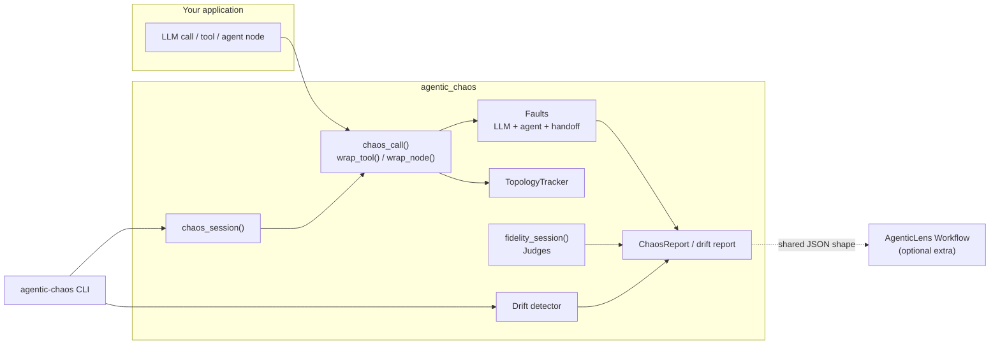
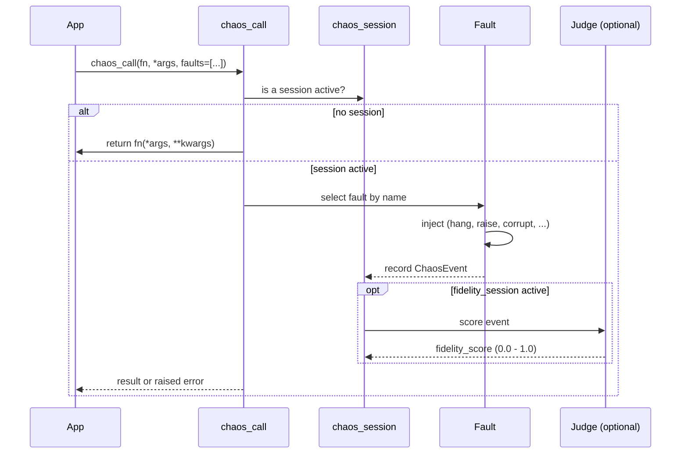
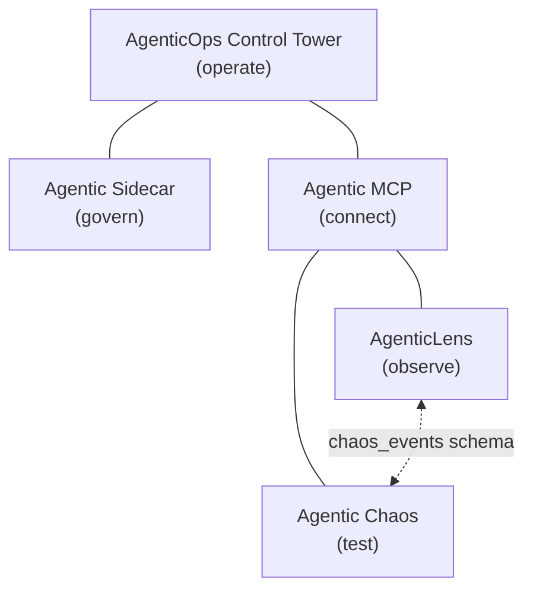

# Architecture

Agentic Chaos is built around one idea: **inject failure at the call sites you choose,
record what happened, and keep everything else out of the way.**

## Design principles

1. **Standalone.** The core has no required third-party dependency. It works against
   any plain Python callable. Eval frameworks and AgenticLens are optional adapters.
2. **Safe to ship.** Outside a `chaos_session(...)`, `chaos_call()` is a transparent
   pass-through: `fn(*args, **kwargs)` runs exactly as if the package were not there.
3. **Explicit.** Chaos only touches calls you wrapped, and when more than one fault is
   active, you must say which one applies at each call site.
4. **Interoperate by file format, not by import.** Reports share a documented JSON
   shape with AgenticLens (schema v1.1). Neither package imports the other at the core
   level.

## Component overview



## Components

| Component | Role |
| --- | --- |
| `chaos_call()` | Wraps a single call. Applies the selected fault when a session is active, otherwise passes through. |
| `chaos_session()` | Context manager that activates a set of faults and collects `ChaosEvent` records on `session.events`. |
| Faults | Objects that implement one failure mode (timeout, rate-limit storm, silent degradation, tool failure, memory corruption, infinite loop, handoff corruption). |
| `wrap_tool()` / `wrap_node()` | Wrap tool and node functions for transparent injection and topology recording. |
| `TopologyTracker` | Records nodes and edges so handoff faults can target an edge and reports can show workflow shape. |
| `fidelity_session()` and judges | Score recorded events to answer "did the corrupted output actually get worse?" |
| Drift detector | Compares a current run against a saved baseline across prompt, model, output and retrieval signals. |
| CLI | Runs a script with faults active (`chaos run`, `agent run`), lists faults, and snapshots or compares drift. |
| `agentic_chaos.integrations.agenticlens` | Optional bridge: `attach_events()` and `step_kwargs()`. |

## What happens during a `chaos_call()`



## Data model

| Object | Purpose | Notable fields |
| --- | --- | --- |
| `ChaosEvent` | One injected fault | `id`, `fault_type`, `outcome`, `step_id`, `step_name`, `message`, `timestamp`, `fidelity_score`, `edge_id`, `from_node`, `to_node`, `detail` |
| `ChaosReport` | The package's standalone report: a collection of events for one run | `id`, `name`, `start_time`, `end_time`, `chaos_events`, `agent_topology`, `drift_report` |
| Topology | Nodes and edges recorded by `TopologyTracker` | nodes, edges (`as_json()`) |
| Drift report | Result of `drift compare` | prompt, model, output and retrieval drift signals |

## Repository layout

```text
agentic-chaos/
├── src/agentic_chaos/     # the package (chaos core, agent faults, judges, drift, CLI, integrations)
├── examples/              # runnable demo scripts
├── tests/                 # test suite
├── docs/                  # this documentation (built with MkDocs)
├── .github/               # CI and release workflows
├── pyproject.toml         # package metadata, extras, uv sources
├── uv.lock                # committed lock used with `uv sync --frozen`
├── Makefile               # install, check, test-cov shortcuts
├── CHANGELOG.md
├── ROADMAP.md
├── CONTRIBUTING.md
└── SECURITY.md
```

## Where it sits in the DeepAgentLabs stack



Agentic Chaos remains a package-first resilience and fault-injection engine. Other
layers can orchestrate or summarize chaos posture, but the testing itself happens here.
