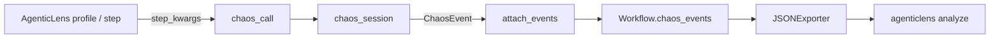

# Integrations

Agentic Chaos is a **standalone** package. It has no required dependency on any other library, and it works against any plain Python callable. Integrations are optional and are always opt-in: the core package never imports them.

| Integration | Install | Purpose |
| --- | --- | --- |
| [AgenticLens](#agenticlens) | `pip install agentic-chaos[agenticlens]` | Merge chaos events into an AgenticLens `Workflow` so cost, latency and chaos impact are analyzed together. |
| [DeepEval](#fidelity-judge-adapters) | bring your own evaluator | Score corrupted output with a DeepEval metric via `DeepEvalJudge`. |
| [Pydantic Evals](#fidelity-judge-adapters) | bring your own evaluator | Score corrupted output with a Pydantic Evals evaluator via `PydanticEvalsJudge`. |
| [Any LLM SDK or framework](#any-sdk-or-framework) | none | Wrap any callable with `chaos_call()`, `wrap_tool()` or `wrap_node()`. |

## AgenticLens

[AgenticLens](https://github.com/DeepAgentLabs/agenticlens) profiles cost and latency of LLM workflows. The optional integration lets `agenticlens analyze` report chaos impact alongside that profile.

!!! note "No code dependency in either direction"
    Only `agentic_chaos.integrations.agenticlens` touches AgenticLens, and only when you import it yourself. `chaos_call()`, `chaos_session()` and the CLI never import it. The two packages interoperate through a shared JSON shape (the `chaos_events` field, workflow schema v1.1).

### Install

```bash
pip install agentic-chaos[agenticlens]
```

!!! warning "Unpublished extra"
    In the source repository the `agenticlens` extra points at a sibling checkout through `[tool.uv.sources]` until AgenticLens publishes a release with `chaos_events` support. See [Troubleshooting](troubleshooting.md#uv-sync-fails-because-of-the-agenticlens-extra).

### Usage

Two helpers do the work:

- `step_kwargs(s)` returns the `step_id` / `step_name` keyword arguments for the current AgenticLens step, so the chaos event is correlated to it.
- `attach_events(session, workflow)` copies the events recorded by the chaos session onto the AgenticLens `Workflow`.

```python
from agenticlens import profile, step
from agenticlens.exporters import JSONExporter
from agentic_chaos.chaos import chaos_call, chaos_session, TokenTimeoutError
from agentic_chaos.integrations.agenticlens import attach_events, step_kwargs

with chaos_session(["token_timeout"]) as session:
    with profile("Customer Support Agent") as workflow:
        with step("Retriever", type="retriever", chunk_count=4) as s:
            try:
                chunks = chaos_call(retriever.search, user_question, **step_kwargs(s))
            except TokenTimeoutError:
                chunks = []
    attach_events(session, workflow)

JSONExporter().export(workflow, "workflow.json")
```

Then analyze the exported workflow:

```bash
agenticlens analyze workflow.json
```

Example output:

```text
Optimization Suggestions
  * Chaos impact: token_timeout on 'Retriever'
    -- Injected fault 'token_timeout' hit step 'Retriever' 1 time and the call
       raised an error each time (call hung for 2.0s then timed out). ... (~0 tokens)
```

A runnable version is in [`examples/chaos_with_agenticlens_demo.py`](https://github.com/DeepAgentLabs/agentic-chaos/blob/main/examples/chaos_with_agenticlens_demo.py).

### Data flow



## Fidelity judge adapters

Fidelity judges score whether corrupted output actually got worse. See [Features](features.md) for the full concept.

- `HeuristicJudge` ships in-core with zero dependencies.
- `DeepEvalJudge` and `PydanticEvalsJudge` are lightweight adapters around **already-constructed** external evaluator objects. Agentic Chaos does not install or import those frameworks for you, so the base package keeps no hard dependency on any eval framework.

```python
from agentic_chaos import SilentDegradationFault, chaos_call, chaos_session, fidelity_session

# my_judge is a DeepEvalJudge or PydanticEvalsJudge wrapping an evaluator you built
with fidelity_session(my_judge):
    with chaos_session([SilentDegradationFault()]) as session:
        answer = chaos_call(agent.answer, "What changed?", faults=["silent_degradation"])

print(session.events[0].fidelity_score)
```

!!! tip
    Check the [API Reference](api-reference.md) for the exact constructor arguments of each adapter.

## Any SDK or framework

Because Agentic Chaos operates on plain callables, it works with any client library or orchestration framework (OpenAI, Anthropic, LangChain, LlamaIndex, custom agents, and so on). Wrap the call that you want to make fragile:

```python
from agentic_chaos.chaos import chaos_call

# Any callable works: an SDK method, a retriever, a tool function, a lambda
response = chaos_call(client.messages.create, faults=["rate_limit_storm"], model="...", messages=[...])
```

For agent frameworks, wrap tools and graph nodes instead:

```python
from agentic_chaos import wrap_tool, wrap_node, TopologyTracker

tracker = TopologyTracker()
tracker.register_node("SupportAgent", type="agent")

search = wrap_tool(search_fn, tool_name="search", tracker=tracker, caller_node="SupportAgent")
```

Positional and keyword arguments are forwarded unchanged to the wrapped function.

## Deep Agentic Core MCP

The separate [`deep-agentic-core-mcp`](https://pypi.org/project/deep-agentic-core-mcp/) package exposes AgenticLens and Agentic Chaos to MCP hosts. Its `chaos.run_experiment` tool runs a workspace-sandboxed target script inside a chaos session and reports the resulting fault events, mirroring `agentic-chaos chaos run`. Agentic Chaos stays the engine; the MCP package is the access layer. Refer to that package's own documentation for setup and current tool names.

## Continuous integration

The CLI exits after running your script, so it can be used in CI to save a report as a build artifact:

```bash
agentic-chaos chaos run my_app.py --inject token_timeout,rate_limit_storm --save chaos_run.json
```

For scheduled drift checks (the command exits with code `2` on drift):

```yaml
name: Drift Check
on:
  schedule:
    - cron: "0 */6 * * *"
  workflow_dispatch:
jobs:
  drift:
    runs-on: ubuntu-latest
    steps:
      - uses: actions/checkout@v4
      - uses: astral-sh/setup-uv@v4
      - run: uv sync --extra dev --frozen
      - run: |
          uv run agentic-chaos drift compare baselines/support-agent.json \
            --prompt-file prompts/support.txt \
            --output-file artifacts/latest-output.txt \
            --save artifacts/drift_report.json \
            --state-path artifacts/drift_state.json \
            --cooldown-minutes 1440 \
            --emit-only-on-change
```

See [Output Formats](output-formats.md) for the report structure and [CLI Reference](cli-reference.md) for all options.

## AI Operations Workflow Specification

Within the wider DeepAgentLabs architecture, Agentic Chaos is the resilience and failure-validation reference implementation for the **AI Operations Workflow Specification**. Its workflow artifacts stay compatible with the shared operational model used by AgenticLens and the MCP layer.
