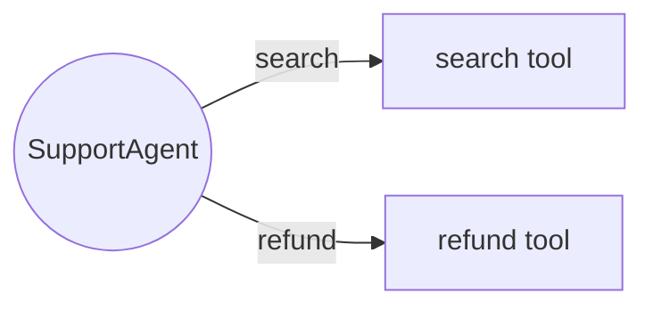

# Output Formats

Agentic Chaos produces three kinds of output: a console table, a standalone JSON report, and (for agent runs) a topology JSON. Optionally, events can also be merged into an AgenticLens workflow.

## Console report

`agentic-chaos chaos run` prints a table of recorded events:

```text
                                  Chaos Events
  Step        Fault           Outcome    Message
 ────────────────────────────────────────────────────────────────────────────
  Retriever   token_timeout   errored    call hung for 2.0s then timed out

1 chaos event(s) recorded.

Saved chaos report to chaos_run.json
```

| Column | Meaning |
| --- | --- |
| Step | The `step_name` you supplied, if any. |
| Fault | The fault type name (for example `token_timeout`). |
| Outcome | What happened at the call site. See [outcomes](#outcomes). |
| Message | A human-readable description of the effect. |

## ChaosEvent

Every injected fault records one `ChaosEvent`. The fields documented for the package are:

| Field | Description |
| --- | --- |
| `fault_type` | Which fault fired. |
| `outcome` | What the call did as a result. |
| `step_id` / `step_name` | Correlation you chose by passing them to `chaos_call()` (or via `step_kwargs()` for AgenticLens). Optional. |
| `fidelity_score` | A `0.0` to `1.0` score, present when a [fidelity session](features.md) is active. |

Events are available from the session object:

```python
with chaos_session([...]) as session:
    ...
for event in session.events:
    print(event.fault_type, event.outcome)
```

### Outcomes

| Outcome | Produced by | Meaning |
| --- | --- | --- |
| `errored` | Error-raising faults (`token_timeout`, `rate_limit_storm`, `tool_failure` in `"error"`/`"timeout"` mode) | The call raised an error. |
| `degraded` | Corruption faults (`silent_degradation`, `memory_corruption`, `tool_failure` in `"empty"` mode, `handoff_corruption` in `"corrupt"`/`"drop"` mode) | The call completed but its output was altered or discarded. |
| `delayed` | `TokenTimeoutFault(mode="delay")`, `HandoffCorruptionFault(mode="delay")` | The call succeeded, but late. |
| `looped` | `InfiniteLoopFault` | The fault replaced the real return value with a "continue" signal. |

## Standalone JSON report (`--save`)

Passing `--save <path>` writes the package's own report, a `ChaosReport`, as JSON:

```bash
agentic-chaos chaos run my_app.py --inject silent_degradation --save chaos_run.json
```

The report needs no other library to produce or read. It contains:

```json
{
  "id": "<uuid>",
  "name": "my_app",
  "start_time": "2026-08-01T10:00:00Z",
  "end_time": "2026-08-01T10:00:02Z",
  "chaos_events": [
    {
      "id": "<uuid>",
      "fault_type": "token_timeout",
      "outcome": "errored",
      "step_name": "Retriever",
      "message": "call hung for 2.0s then timed out",
      "timestamp": "2026-08-01T10:00:01Z",
      "fidelity_score": null,
      "detail": {"hang_seconds": 2.0, "mode": "raise"}
    }
  ],
  "agent_topology": null,
  "drift_report": null
}
```

Read it back with any JSON tool:

```bash
python -m json.tool chaos_run.json
jq '.chaos_events[] | {fault_type, outcome}' chaos_run.json
```

### Probes and resilience (0.9.0)

Reports also carry the steady-state probe results and the resilience score:

```json
{
  "probes": [
    {"probe": "answers", "kind": "response_quality", "phase": "post", "status": "passed",
     "message": "answer meets every quality check", "attempts": 1, "duration_ms": 0.4,
     "weight": 1.0, "started_at": "2026-10-31T02:00:01+00:00", "observed": {"output": "'Answer: ...'"}}
  ],
  "resilience": {
    "version": "1.0", "score": 92, "status": "scored", "grade": "A",
    "components": [{"name": "recovery", "score": 1.0, "weight": 0.35,
                    "detail": "3/3 injections recovered", "observed": {"retried": 3}}],
    "faults": [{"fault_type": "rate_limit_storm", "events": 3, "score": 100,
                "verdicts": {"retried": 3}, "note": "3 retried"}],
    "reasons": [], "trend": {"previous": 84, "delta": 8, "direction": "up"}
  }
}
```

`resilience.score` is `null` (status `inconclusive`) when it cannot be computed;
`reasons` says why. Both fields are absent from, and optional on, older reports.

### Agent runs

`agentic-chaos agent run ... --save report.json` writes the same style of report for agent-level faults (`tool_failure`, `memory_corruption`, `infinite_loop`, `handoff_corruption`).

## Topology JSON

`TopologyTracker` records nodes and edges while you use `wrap_tool()` / `wrap_node()`:

```python
print(tracker.topology.as_json())  # nodes + edges
```

Nodes are registered with `tracker.register_node(name, type=...)`. Edges are recorded between caller nodes and the tools or nodes they call. Handoff chaos targets these edges rather than nodes.



## AgenticLens `chaos_events`

When you use the [AgenticLens integration](integrations.md#agenticlens), `attach_events()` copies events onto the `Workflow`. To attach a drift report as well, use `attach_drift_report(report_dict, workflow)` from the same module. Exporting with `JSONExporter` then includes `chaos_events` and `drift_report` fields, following the documented shared JSON shapes (workflow schema v1.1 and v1.4).

`agenticlens analyze workflow.json` turns those events into an "Optimization Suggestions" entry such as:

```text
* Chaos impact: token_timeout on 'Retriever'
  -- Injected fault 'token_timeout' hit step 'Retriever' 1 time and the call
     raised an error each time (call hung for 2.0s then timed out). ... (~0 tokens)
```

## Drift report and state

`agentic-chaos drift snapshot --save baseline.json` writes a baseline snapshot, and `drift compare ... --save drift_report.json` writes a drift report. The comparison covers four signal types:

| Signal | Based on |
| --- | --- |
| Prompt drift | Hash and inline diff metadata of the prompt file. |
| Model drift | Model name, provider fingerprint and embedding-model metadata. |
| Output drift | A lightweight text-distance score against the baseline output. |
| Retrieval drift | Set distance on fixed retrieval results. |

`--state-path` (for example `.agentic-chaos/drift-state.json`) stores state used by `--cooldown-minutes` and `--emit-only-on-change`, so scheduled runs stay quiet until something changes.

**Exit codes:** `drift compare` exits with `2` when drift is detected, otherwise it follows normal CLI conventions.

### Drift snapshot fields

A snapshot saved with `drift snapshot --save baseline.json` has these top-level fields:

| Field | Type | Description |
| --- | --- | --- |
| `id` | string (UUID) | Auto-generated snapshot ID |
| `name` | string | The `--name` you supplied |
| `captured_at` | datetime string | UTC timestamp of capture |
| `prompt_text` | string or null | Full prompt text (from `--prompt-file`) |
| `prompt_hash` | string or null | SHA-256 of normalised prompt |
| `model_name` | string or null | From `--model` |
| `model_fingerprint` | string or null | From `--model-fingerprint` |
| `output_text` | string or null | From `--output-file` |
| `output_hash` | string or null | SHA-256 of normalised output |
| `retrieval_items` | list of strings | From `--retrieval-file` or `--retrieval-item` |
| `retrieval_hash` | string or null | SHA-256 of joined retrieval items |
| `embedding_model` | string or null | From `--embedding-model` |
| `metadata` | dict | Reserved for future use |

### Drift report fields

A drift report saved with `drift compare --save drift_report.json` has these top-level fields:

| Field | Type | Description |
| --- | --- | --- |
| `id` | string (UUID) | Auto-generated report ID |
| `name` | string | Name from the current snapshot |
| `compared_at` | datetime string | UTC timestamp of comparison |
| `baseline_snapshot_id` | string | ID of the baseline snapshot |
| `current_snapshot_id` | string | ID of the current snapshot |
| `has_drift` | boolean | `true` when any finding has `changed=true` |
| `findings` | list of `DriftFinding` | One entry per signal checked (prompt, model, output, retrieval) |
| `baseline` | dict | Metadata from the baseline snapshot |
| `current` | dict | Metadata from the current snapshot |

Each `DriftFinding` has: `kind` (`"prompt"`, `"model"`, `"output"`, `"retrieval"`), `changed` (boolean), `score` (float or null), `threshold` (float or null), `message`, `detail`.
