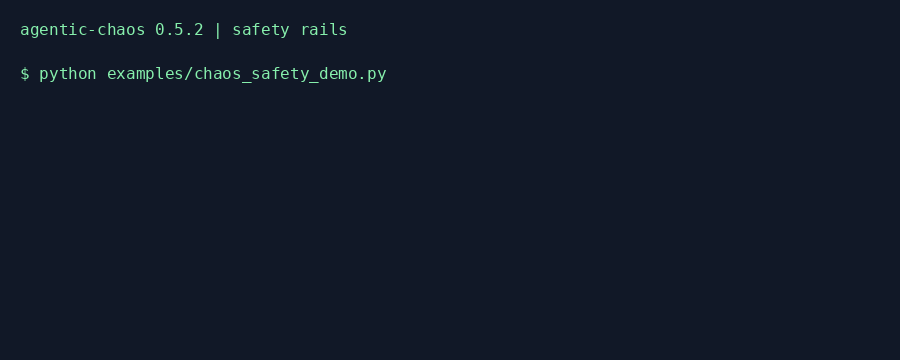

# Safety rails (0.5.2)

Safety rails are cooperative guards on instrumented work. Use them with
`chaos_call`, `chaos_acall`, `chaos_stream`, `chaos_astream`, and explicit provider
patches. The package remains standalone; SDKs and sibling projects are optional.

```python
from agentic_chaos import CircuitBreaker, ChaosAbortedError, chaos_call, chaos_session

with chaos_session([], breaker=CircuitBreaker(
    max_cost_usd=5.0, max_failure_rate=0.5, window_size=20, min_calls=5,
    max_duration_seconds=60, max_injections=100,
)) as session:
    try:
        result = chaos_call(lambda: "offline result")
        session.record_usage(input_tokens=100, output_tokens=50,
                             input_usd_per_million=1, output_usd_per_million=2)
    except ChaosAbortedError:
        print(session.report_fields())
```

## Limits and accounting

- Cost aborts at or above `max_cost_usd`. Call `session.record_cost(cost_usd)` or
  `record_usage(...)` with measured tokens and supplied per-million prices.
  No provider prices or response usage are guessed. An unreported cost cannot
  trigger this limit. Accounting after a call can overshoot the budget by that
  call's cost. Record reservations before a call if pre-dispatch budgeting is needed.
- Failure rate aborts **above** `max_failure_rate`, using the last `window_size`
  completed wrapped operations, after `min_calls` completions. An escaping
  exception counts as failure; degradation and stream cuts do not imply a
  failed target operation. Stream consumption counts once, not once per chunk.
  Stream-provider creation is a separate guarded operation. Cancellation counts
  as a failed completion when its worker finishes. This is operational exception
  rate, not recovery quality or a resilience score.
- `max_injections` reserves capacity before fault execution and commits the
  count only when a fault event is produced. Eventless completions release their
  reservation. Built-in pass-through predicates skip admission. The next eligible injection
  attempt aborts. It does not count preview records. Slow-stream delay faults
  count once per stream even if they delay multiple chunks.
- Duration is elapsed monotonic time checked at admission, dispatch, stream
  iteration/delivery boundaries, and completion. It is cooperative: blocking
  target calls, upstream reads, and bounded fault sleeps can exceed the duration
  before the next check. There is no timer that kills arbitrary code.
- Limits validate finite values and positive integer windows/counts. Failure
  rates lie in `[0, 1]`; `min_calls` cannot exceed `window_size`. Breaker
  configuration is copied into fresh state on each session entry.

Abort is sticky. Catching `ChaosAbortedError` does not re-enable dispatch.
Shared locked state covers async workers and inherited tasks; queued async
provider work checks again on the event loop before entering its target.
A session that has ended rejects inherited instrumented work.

Already-running calls can finish after abort. `in_flight_at_abort` records how
many wrapped operations were running when the threshold fired; `in_flight`
records outstanding operations when the report is captured. Reports are snapshots,
not a guarantee that external work stopped. Direct calls and custom fault code
that bypass these wrappers remain outside this boundary. The containment tests
include a deliberately bypassed direct call as a negative control.

## Dry-run

```bash
agentic-chaos chaos run examples/chaos_customer_support_demo.py \
  --inject rate_limit_storm --dry-run --save preview.json
agentic-chaos agent run my_agent.py --profile staging --profile-file chaos.toml \
  --dry-run --max-duration-seconds 30 --save preview.json
```

`chaos_session(..., dry_run=True)` uses the same configured selection and seeded
probability, tool/edge predicates, and finite burst/turn state. Selection RNG and
preview counters use private copies; original fault state stays unchanged.
Custom pass-through faults should implement `eligible()` and, if stateful,
`advance_preview()` (use independent scalar preview state); their trigger is
never executed to discover eligibility during dry-run. It executes targets and delivers original stream chunks without
fault mutation, delay, error, or skipped calls. This can still make real API calls
and spend money. Preview records live in `planned_events` (`would_inject`) rather
than `chaos_events`, so consumers do not mistake a plan for an observed failure.
For streams, a plan is recorded when consumption reaches the configured fault
boundary. An unconsumed stream has no plan. Multiple faults still require explicit
call-site selection. Safety limits also apply during preview.

Both CLI run commands support `--max-cost-usd`, `--max-failure-rate`,
`--failure-window`, `--min-calls`, `--max-duration-seconds`, `--max-injections`,
and `--dry-run`. They save evidence even when the target raises or catches an
abort; an aborted command exits nonzero.

## Reports and sibling compatibility

Build a native report with the session's additive safety fields:

```python
from datetime import datetime, timezone
from agentic_chaos.models import ChaosReport

report = ChaosReport(name="experiment", start_time=datetime.now(timezone.utc),
                     chaos_events=session.events_as_json(), **session.report_fields())
```

The fields are `aborted`, `abort_reason` (threshold, limit, observed value,
`in_flight_at_abort`), `dry_run`, `planned_events`, `cost_usd`, `injections`, and
`in_flight`. Old reports load with defaults. The native event shape is unchanged.
AIOS export preserves these fields under the existing
`io.deepagentlabs.agentic-chaos.safety` extension and maps abort to Run
`cancelled`; preview adds no synthetic occurrence or reliability evidence.
No new canonical AIOS type is invented.

Compatibility tests exercise Lens's Workflow parser, Tower's native report
reader, MCP's saved-report AIOS export, and AIOS schema/semantic validation.
Existing consumers accept additive fields, but their native views need not display
abort/preview metadata. MCP's existing `run_experiment` does not expose the new
CLI flags or populate safety fields automatically. Use the Python API or CLI for
safety-controlled execution; the saved-report export preserves its metadata.
No sibling runtime dependency or patch release is required for these compatible
artifacts. The development lock includes Lens 0.6.1 and Evals 0.7.1; CI checks out
current Lens, Tower, MCP, and AIOS sources.

Run `uv run python examples/chaos_safety_demo.py` for the offline example.
Regenerate the demo with
`uv run --with pillow python scripts/generate_safety_demo.py`.


