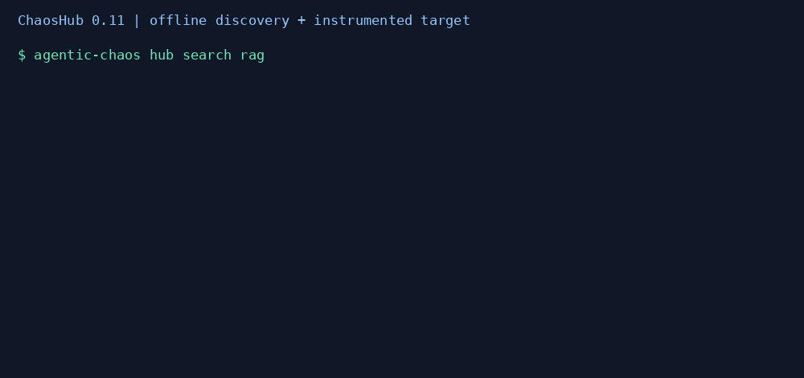

# ChaosHub (0.11.0)

Discover an offline starting scenario, bind your instrumented app, and inspect
native resilience evidence. This is a minor delivery; ecosystem v1.0 acceptance
and AIOS stability remain separate.

## Getting started in 30 seconds

```bash
pip install agentic-chaos
agentic-chaos hub list
agentic-chaos hub search rag
agentic-chaos hub pull rag-context-poisoning recipe.json
agentic-chaos chaos run examples/chaoshub_app.py --experiment rag-context-poisoning --save hub-report.json
```

Use the [offline example](https://github.com/DeepAgentLabs/agentic-chaos/blob/main/examples/chaoshub_app.py)
from this checkout, or replace it with your own Python script using `chaos_call`,
`wrap_tool` or `wrap_node`. Direct script binding uses bundled recipes only,
preserves fault constructor settings and built-in assertions, and defaults to
at most 10 admitted injections. Normal CLI safety overrides still apply.
The recipe's placeholder target is never imported by `--experiment`.
Injected/planned events carry `detail.hub` with the bundled name, source and
SHA-256 of the canonical recipe JSON (sorted keys, compact separators).



## Recipes and interpretation

| Recipe | Simulated boundary | Existing fault primitive |
| --- | --- | --- |
| rag-retriever-failure | Retriever timeout | token_timeout |
| rag-context-poisoning | Contradictory context response | poisoned_response |
| react-loop-resilience | Tool failure in a reasoning loop | tool_failure |
| multi-agent-coordinator-down | Coordinator timeout | token_timeout |
| support-escalation-failure | Corrupted support memory | memory_corruption |
| api-cascade-storm | Downstream API 429 storm | rate_limit_storm |

These are framework-neutral starter recipes, not native vector-database,
embedding, coordinator or support-service adapters. Instrument the relevant
call boundary in your app. A recipe name does not prove every scenario in that
pattern was exercised. The default `no_unhandled_error` assertion checks
availability only; supply quality probes, recovery contracts or native
containment assertions for stronger claims. API cascade here means a burst of
rate-limit errors; use v0.8 workflow stages for a multi-tool campaign.

Bundled and remote recipes are v0.8 experiment JSON documents (also valid YAML).
JSON keeps offline discovery and pull free of the optional PyYAML dependency.
To customize, pull, edit `target` and fault scopes, add probes and assertions,
then use `agentic-chaos experiment validate recipe.json` and
`agentic-chaos experiment run recipe.json`. Standard experiment target rules
apply, including explicit paths relative to the downloaded file.

## Python API

```python
from pathlib import Path
from agentic_chaos.hub import list_recipes, recipe, pull, push
from agentic_chaos.experiments import load_experiment

print(list_recipes("rag"))
document = recipe("react-loop-resilience")
document["target"] = "examples/chaoshub_app.py:main"
experiment = load_experiment(document)
report = experiment.workflow.run()
report.save("campaign.json")
pull("rag-context-poisoning", Path("recipe.json"))
push(Path("recipe.json"), Path("/path/to/registry-checkout"))
```

`pull` and `push` refuse to overwrite existing files, validate without importing
targets, and reject path-like recipe names. `push` stages a JSON contribution in
`hub/recipes/`; it does not authenticate, commit or submit a pull request.
Update `hub/index.json` in that checkout and follow
[the contribution workflow](https://github.com/DeepAgentLabs/agentic-chaos/blob/main/hub/CONTRIBUTING.md).
The repository's ordinary pull-request CI checks the catalog and all recipes.

## Opt-in GitHub registry

The registry is `DeepAgentLabs/agentic-chaos`, under `hub/index.json` and
`hub/recipes/`. Choose a reviewed **full 40-character lowercase commit SHA**
from its Git history; no mutable branch or tag is accepted.

```bash
agentic-chaos hub list --repository DeepAgentLabs/agentic-chaos --ref COMMIT_SHA
agentic-chaos hub search rag --repository DeepAgentLabs/agentic-chaos --ref COMMIT_SHA
agentic-chaos hub pull rag-context-poisoning remote.json --repository DeepAgentLabs/agentic-chaos --ref COMMIT_SHA
agentic-chaos hub push my_experiment.yaml /path/to/registry-checkout
```

Replace `COMMIT_SHA` with that commit. Network reads use a 15-second timeout
and a 1 MiB response limit. The downloaded recipe's name must match the request.
Remote catalog rows are attributed with repository and commit; installed plugin
names are listed separately. Private registries/authentication are not supported.

Review every executable target, workflow node, probe and endpoint before running
a downloaded recipe. Validation checks structure, not trustworthiness; a commit
pin fixes bytes but does not endorse their author. No remote execution, automatic
network access, scheduling or hosted MCP tool is added.

## Fault plugins

Export a concrete `BaseFault` subclass under a matching entry-point name:

```toml
[project.entry-points."agentic_chaos.plugins"]
custom_timeout = "my_faults:CustomTimeoutFault"
```

```python
from agentic_chaos.chaos.faults import TokenTimeoutFault

class CustomTimeoutFault(TokenTimeoutFault):
    name = "custom_timeout"
```

`hub list` enumerates installed packages' entry points without importing them.
Enable trusted installed plugin code with `chaos run app.py --plugins --inject
custom_timeout`, or call `agentic_chaos.hub.plugins.load_plugins()` before using
`resolve_faults` or compiling experiments. Plugins use the existing `BaseFault`
ABC and must support a zero-argument constructor for name-only CLI use. Declarative
constructor options remain limited to the experiment compiler's supported fields.

Loading validates all entry points before registry mutation, rejects built-in or
plugin-name collisions, and requires concrete subclasses with matching names.
It executes installed Python code, so it is explicit; no plugin auto-import
occurs merely by installing a distribution or listing recipes. Load once per
process; a second registration of the same name is a collision.

## Ecosystem compatibility

| Consumer | Version / change | Ownership |
| --- | --- | --- |
| Sidecar | 0.10.1 widens optional Chaos ranges to `<0.12` | Supervision remains Sidecar-owned |
| MCP | 0.6.6 hosted image pins Chaos 0.11.0 and Sidecar 0.10.1 | No new hub tool; hosted script execution stays disabled |
| Lens | 0.13.0, existing optional range | Reads native events, caller instruments spans |
| Evals | 0.12.0, no dependency change | Output scoring and release gates |
| Tower | 0.10.0, existing `<1` range | Native evidence tallies, separate deployment health |
| AIOS | repository 0.7.0, unchanged exports | Draft semantics; recipes are producer configuration |

No shared object or native report schema changed. Existing scored-report,
AIOS-export and sibling artifact regression tests cover the report path;
`tests/test_hub.py` covers recipe validation, pinned exchange, catalog integrity,
plugin collisions and direct script binding. Documentation-only siblings need
no patch release.
