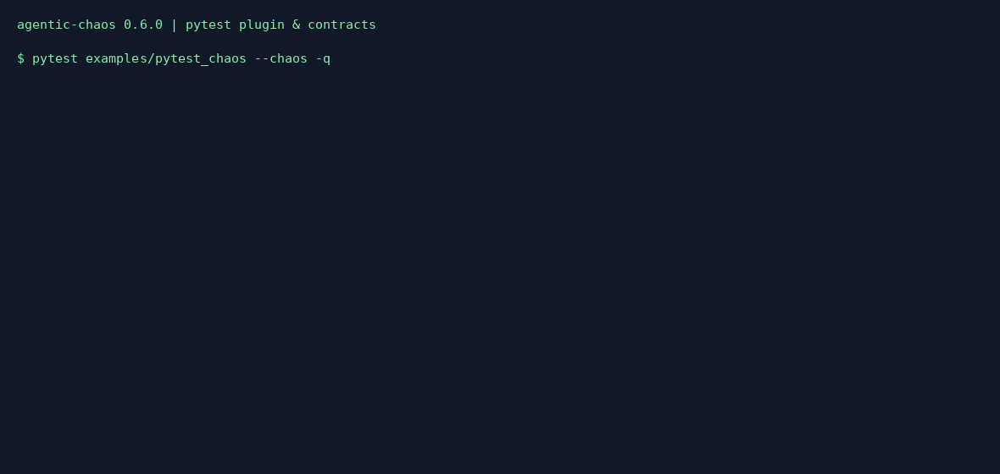

# Pytest plugin & chaos contracts (0.6.0)

v0.6 makes chaos part of an ordinary test run. A `@pytest.mark.chaos` test
runs inside a chaos session when pytest is started with `--chaos`, and its
**contracts** — pass/fail resilience checks — decide whether it passes.
Without `--chaos` the marker does nothing and the test runs normally.

The plugin and the contracts ship in the `agentic-chaos` distribution. The
package stays standalone: no sibling package is required, and pytest is only
needed if you use the plugin (`pip install "agentic-chaos[pytest]"`).

## Quick start

```python
import pytest
from agentic_chaos.contracts import MaxRetries, NoRetryStorm

@pytest.mark.chaos(faults=["rate_limit_storm"], must_recover=True)
def test_agent_handles_rate_limits():
    result = my_agent("What's the weather?")
    assert result is not None

@pytest.mark.chaos("rate_limit_storm", contracts=[MaxRetries(3), NoRetryStorm(5)])
def test_retry_budget_is_bounded():
    assert my_agent("What's the weather?")
```

```bash
pytest                    # markers inert: tests run normally
pytest --chaos            # faults injected, contracts checked
pytest --chaos --chaos-report-dir chaos-reports --chaos-contract no_retry_storm:10
```

The code under test must be instrumented the usual way: `chaos_call()`,
`chaos_acall()`, `chaos_stream()`, `wrap_tool()`/`wrap_node()` or a provider
patch. Outside a session these are plain calls, so the same code runs in
production and in the non-chaos test run.

## Marker reference

`@pytest.mark.chaos(faults=None, *, profile=None, profile_file="chaos.toml",
contracts=(), must_recover=False, baseline=False, breaker=None, dry_run=False)`

| Argument | Meaning |
|---|---|
| `faults` | Fault names (list or comma-separated string) or fault instances. May be the only positional argument. Instances are deep-copied per run, so burst counters and RNG state never leak between tests or parametrized cases. |
| `profile`, `profile_file` | A named `chaos.toml` profile instead of `faults` (exactly one of the two is required). Relative paths resolve against the working directory. |
| `contracts` | `Contract` instances or spec strings such as `"max_retries:3"`, or a single instance. |
| `must_recover` | Adds `RecoveredAfterFailure()` unless one is already listed. |
| `baseline` | Run the test once as a **dry run** first (same fault selection, nothing injected), then under chaos. The dry run is the baseline for `MaxCostImpact` and `FullTopologyTraversal`. A failing baseline fails the test with a clear message. |
| `breaker` | A `CircuitBreaker` for the session (see the [safety guide](safety.md)). |
| `dry_run` | Preview only: target calls run unchanged and planned faults are recorded. Cannot be combined with `baseline=True`. |

Invalid arguments (unknown fault or contract, both or neither of
`faults`/`profile`, a missing profile file) fail that test with
`invalid @pytest.mark.chaos: ...` before it runs.

A contract that fails **or is inconclusive** fails the test with a
`ContractViolationError` (an `AssertionError`) whose message lists every
result. If the test body itself raised, that error is re-raised and the
contract results appear in a "chaos contracts" report section. `pytest.skip`,
`pytest.xfail` and `pytest.exit` pass straight through; they produce no
chaos result.

### Options

| Option | ini | Meaning |
|---|---|---|
| `--chaos` | `chaos = true` | Activate chaos markers. |
| `--chaos-report-dir DIR` | `chaos_report_dir` | Write `<nodeid>.chaos.json` (the native `ChaosReport`), `<nodeid>.baseline.json` and `<nodeid>.contracts.json` per chaos test. |
| `--chaos-contract SPEC` | — | Add a contract to every chaos test. Repeatable. |

The terminal summary prints an `agentic-chaos` section with the number of
chaos tests, fault events and contract passes, and lists every failing
result. Disable the plugin entirely with `-p no:agentic_chaos`.

### The `chaos` fixture

```python
@pytest.mark.chaos(faults=["tool_failure"], baseline=True,
                   contracts=[FullTopologyTraversal()])
def test_every_node_runs(chaos):
    tracker = chaos.attach_topology(TopologyTracker(auto_activate=False))
    run_graph(tracker)
    chaos.record_cost(0.002)          # feeds MaxCostImpact(metric="cost_usd")
    assert chaos.session.events       # the live ChaosSession
```

`chaos.session` is the active session (the dry-run one during a baseline run),
`chaos.enabled`/`chaos.active` say whether chaos is on, and `record_cost()`,
`record_usage()` and `attach_topology()` are no-ops when it is off, so the
same test body works with and without `--chaos`. A `TopologyTracker` the test
creates with the default `auto_activate=True` is picked up automatically and
deactivated afterwards. After the call, `chaos.report`, `chaos.baseline_report`
and `chaos.contract_report` hold the results for teardown code.

### Async tests

Coroutine tests run by pytest-asyncio or anyio work. Those plugins run the
coroutine in an event-loop context created before the session exists, so the
plugin wraps the coroutine function and binds the session inside the task.
A tracker created inside the coroutine is still picked up.

### Caveats

- `baseline=True` calls the test function twice with the **same fixture
  instances**. Fixtures that are consumed or mutated by the test should be
  function-scoped and idempotent, or skip the baseline.
- Contracts see only instrumented calls. Work that bypasses the wrappers is
  invisible to retry, traversal and call-count contracts.
- Dry runs still execute target calls and can spend money; see the
  [safety guide](safety.md).

## Contracts

Contracts are plain Python and also work outside pytest:

```python
from agentic_chaos import chaos_session
from agentic_chaos.contracts import MaxRetries, NoUnhandledError, assert_contracts

error = None
with chaos_session(["rate_limit_storm"]) as session:
    try:
        my_agent("What's the weather?")
    except Exception as exc:
        error = exc
report = session.to_report("weather", error=error)
assert_contracts(report, [NoUnhandledError(), MaxRetries(3)])  # raises ContractViolationError
```

`check_contracts(report, contracts, baseline=None)` returns a `ContractReport`
(`passed`, `failures`, `summary()`, `as_json()`, `raise_for_failures()`).
`report` and `baseline` may be a `ChaosReport`, its JSON dict, or a path to a
saved report.

Every result has a status:

- `passed`
- `failed`
- `inconclusive` — the report cannot show what the contract needs: no
  baseline, no injected failure, a truncated call log, a run that never
  ended, or a report written before 0.6 that has no `calls` /
  `unhandled_error` field. An explicit `"unhandled_error": null` is evidence
  that nothing escaped; a missing field is not.

**Inconclusive never passes.** A contract that cannot be evaluated is not
evidence of resilience, so CI fails closed.

| Contract | Spec | Passes when |
|---|---|---|
| `CompletesWithin(timeout_s)` | `completes_within:30` | report `end_time - start_time` ≤ `timeout_s`. Inconclusive without `end_time`. |
| `NoUnhandledError()` | `no_unhandled_error` | no exception escaped the code under test (`unhandled_error` is empty). |
| `MaxRetries(n, step=None)` | `max_retries:3,step=search` | no named step was retried more than `n` times in a row. |
| `RecoveredAfterFailure(require_step_success=False)` | `recovered_after_failure:require_step_success=true` | at least one `errored` fault event, no escaped exception, and no breaker abort. With `require_step_success`, every step hit by an injected failure must also succeed later (a fallback alone does not count). Inconclusive when nothing was injected. |
| `MaxCostImpact(factor, metric="cost_usd", baseline_value=None)` | `max_cost_impact:2,metric=calls` | chaos value ≤ `factor` × baseline. `cost_usd` uses explicitly recorded cost; `calls` counts instrumented calls (including dropped ones). Inconclusive without a baseline or when neither run recorded anything. |
| `NoRetryStorm(max_retries_per_window, window_seconds=60)` | `no_retry_storm:5,window_seconds=10` | at most N retries, **across all steps**, within any sliding window. Catches a fault on one agent that sets off retries in its callers while each step stays under its own `MaxRetries`. |
| `FullTopologyTraversal(expected_nodes=None, ignore=())` | `full_topology_traversal:expected_nodes=Planner\|Reviewer` | every node visited in the baseline (or listed in `expected_nodes`) was visited under chaos. |

Spec strings are `name` or `name:arg,...`, where each arg is positional or
`key=value`; list values separate items with `|`. `agentic-chaos contracts
list` prints them all.

### Definitions

- **Call log.** Each instrumented operation (`chaos_call`, `chaos_acall`, one
  record per stream) appends a record to `ChaosReport.calls`: `sequence`,
  `kind` (`call` or `stream`), `step_id`, `step_name`, `started_at`,
  `duration_s`, `status` (`ok` or `error`), `error_type`, and `fault_type` /
  `event_id` when a fault event hit it. The log keeps 10,000 records per
  session and counts the rest in `calls_dropped`; retry and storm contracts
  are inconclusive once anything is dropped.
- **Retry.** A call to a step (same `kind` and `step_name`, or `step_id` if
  there is no name) whose previous call to that step raised. A success ends
  the step's streak. Calls with neither name are never treated as retries of
  each other, and `MaxRetries` reports how many such unnamed calls there were.
  Calls are ordered by when they started, so concurrent calls to the same
  step can look like retries of one another; give fan-out branches distinct
  step names.
- **Visited node.** An endpoint of a recorded topology edge, or the
  `step_name` of an instrumented call. Registering a node alone is not a
  visit, so a pre-registered reviewer that never runs is reported missing.
- **Unhandled error.** The exception that escaped the code under test, as
  recorded by `session.to_report(..., error=exc)`, the pytest plugin, or the
  CLI when the script crashes. It includes `fault_type` and `event_id` when it
  is a fault exception.

## CLI

```bash
# Gate a script run on contracts (exit 1 unless all pass).
agentic-chaos chaos run app.py --inject rate_limit_storm \
  --contract no_unhandled_error --contract max_retries:3 \
  --save chaos.json --save-contracts contracts.json

# Record a baseline (dry run), then compare a chaos run against it later.
agentic-chaos chaos run app.py --inject rate_limit_storm --dry-run --save baseline.json
agentic-chaos contracts check chaos.json --baseline baseline.json \
  --contract max_cost_impact:2,metric=calls --contract full_topology_traversal

agentic-chaos contracts list
```

`--contract`, `--baseline` and `--save-contracts` work on `chaos run` and
`agent run`. Exit codes: a script's own failing `sys.exit()` code first, then
1 for a breaker abort, then 1 for a contract that did not pass. Invalid specs
and unreadable baselines fail before the script runs.

## Reports and the ecosystem

The new native report fields are additive and default to empty, so older
reports still load (contracts that need them are inconclusive on such
reports):

| Field | Meaning |
|---|---|
| `calls` | the call log above |
| `calls_dropped` | records not kept once the log was full |
| `unhandled_error` | `{type, message, fault_type?, event_id?}` or `null` |

- **AgenticLens** loads these reports as `Workflow` JSON unchanged; the extra
  fields are ignored and `chaos_events` are analysed as before.
- **Control Tower** native artifact readers summarize them as before.
- **MCP** `chaos.export_aios_run` and this package's `to_aios_run()` carry
  `calls: {recorded, dropped}` and `unhandled_error` in the existing
  `io.deepagentlabs.agentic-chaos` extension. The per-call records stay in the
  native report. No core AIOS object changes, and exports still validate
  against the v0.4-draft run schema.
- Contract results are this package's own verdict JSON
  (`ContractReport.as_json()`), not AIOS evidence. Scoring and release-gate
  computation remain Agentic Evals' responsibility. A contract is a check over
  one chaos run, not a release gate.

These checks run in this repository's sibling-integration CI job. No sibling
package needs to change at runtime. Sidecar's optional `agentic-chaos` extra
was capped below 0.6 and is widened in Sidecar 0.8.1.

## Example

- [`examples/chaos_contracts_demo.py`](../examples/chaos_contracts_demo.py):
  the Python API offline. A resilient agent passes, a fragile one fails, and a
  skipped reviewer is caught.
- [`examples/pytest_chaos/`](../examples/pytest_chaos): a pytest suite to run
  with and without `--chaos`, including a strict xfail in which a contract
  catches a fallback that hides an unrecovered step.
- [`examples/github-actions-chaos.yml`](../examples/github-actions-chaos.yml):
  a CI workflow that runs chaos tests, gates a CLI run and uploads the reports.


