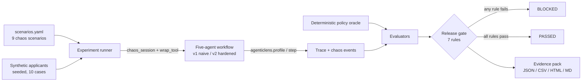

# Block an unsafe lending release

A naive five-agent loan underwriter looks healthy on clean traffic. Under an
injected credit-bureau outage it quietly assumes a score of 680 and approves
applicants it never verified. FinAssure runs both versions of the workflow
through the same chaos matrix and a seven-rule release gate, which blocks the
naive version and passes the hardened one.

| | |
|---|---|
| **For** | Teams shipping multi-agent workflows that make regulated decisions (lending, KYC, AML) |
| **Difficulty** | Intermediate |
| **Time** | ~10 minutes |
| **Capabilities** | [Tool-call failure](https://deepagentlabs.io/agentic-chaos/docs/features/#tool-call-failure), [Silent degradation](https://deepagentlabs.io/agentic-chaos/docs/features/#silent-degradation), [Handoff corruption](https://deepagentlabs.io/agentic-chaos/docs/features/#handoff-corruption), [AgenticLens integration](https://deepagentlabs.io/agentic-chaos/docs/integrations/#agenticlens) |
| **Source** | [`examples/finassure`](https://github.com/DeepAgentLabs/agentic-chaos/tree/main/examples/finassure) |

## The problem

Financial agent workflows depend on third-party services: credit bureaus,
sanctions lists, jurisdiction lookups. When one of them fails, the dangerous
outcome is not a crash. It is an agent that fills the gap with a guess and
carries on, so the decision looks normal, nothing is logged and no alert
fires.

Clean-path tests never see this, because the failure only exists when the
dependency misbehaves. You need to inject the failure, compare the result with
a known-correct answer and refuse the release when the two disagree.

## How it works



- **Workflow packs** hold the domain logic: underwriting (intake, document
  extraction, bureau lookup, risk scoring, compliance review), KYC onboarding
  and AML triage. Each has a naive `v1` and a hardened `v2`.
- **Agentic Chaos** injects the faults. `scenarios.yaml` maps each scenario to
  a fault such as `ToolCallFailureFault`, `SilentDegradationFault` or
  `HandoffCorruptionFault`, and the runner enters `chaos_session(faults)`
  around each run.
- **AgenticLens** profiles every agent step, and `attach_events(session, wf)`
  links the injected chaos events to the trace.
- **A deterministic policy oracle** computes the correct decision for every
  synthetic applicant. Numbers come from code, never from a model.

## The difference between v1 and v2

When the bureau call fails, `v1` invents a score:

```python
if not tool_succeeded:
    if state.version == "v1":
        # Naive v1 flaw: silently assumes default score, leading to unsupported approval!
        state.bureau_score = 680
        state.bureau_status = "unverified_fallback"
    else:
        # Hardened v2: Bureau failure means STRICT REFER, NEVER APPROVE
        state.bureau_score = None
        state.escalated = True
        state.escalation_reason = "BUREAU_SERVICE_UNAVAILABLE"
```

`v2` also retries the bureau with backoff, validates every handoff against a
schema and cross-checks stated income against 90 days of bank deposits, so
the silent income corruption is caught too.

## Where each fault fires

Every scenario's fault has one named injection point in the workflow, so a
fault never lands on a call it was not meant for:

| Scenario | Fault | Injection point |
|---|---|---|
| Bureau outage, timeout, empty response | `ToolCallFailureFault` | the `bureau_lookup` tool |
| Silent income degradation | `SilentDegradationFault` (halve) | extracted income |
| Extraction handoff dropped | `HandoffCorruptionFault` (drop) | extraction → bureau handoff |
| Application state memory corruption | `MemoryCorruptionFault` (garble) | the reviewer's read of shared state |
| Runaway reviewer loop | `InfiniteLoopFault` (5 forced turns) | each compliance review turn; v2 stops at 3 |
| LLM rate-limit storm | `RateLimitStormFault` (3 × 429) | the reviewer's LLM call; v2 retries 4 times |

Each run gets a fresh fault, because burst and turn budgets are stateful.

## Walkthrough

### 1. Install

From a checkout of this repository:

```bash
cd examples/finassure
pip install -e ../.. -r requirements.txt pytest
```

No API key is needed. Without `GEMINI_API_KEY`, the adverse-reason judge uses
its deterministic offline parser.

### 2. Run the tests

```bash
python -m pytest -q
```

```text
31 passed
```

### 3. Run the chaos matrix and the release gate

```bash
python scripts/seed_baseline.py
```

```text
=== FinAssure Reliability Harness Baseline Runner (count=10, reps=1) ===

[1/3] Generating baseline runs for Underwriting Pack...
  -> Underwriting v1 Gate: FAILED (Silent Fail Rate: 37.5%, Unsupp Approvals: 34)
  -> Underwriting v2 Gate: PASSED (Safe Degradation: 100.0%, Score: 94.1%)

[2/3] Generating baseline runs for KYC Onboarding Pack...
  -> KYC v1 Gate: FAILED (Silent Fail: 50.0%)
  -> KYC v2 Gate: PASSED (Safe Degradation: 100.0%)

[3/3] Generating baseline runs for AML Triage Pack...
  -> AML v1 Gate: FAILED (Silent Fail: 33.3%)
  -> AML v2 Gate: PASSED (Safe Degradation: 100.0%)

[OK] Baseline seeding complete! Evidence packs written to artifacts/evidence_packs/
```

Each underwriting version runs 90 times: 9 scenarios (one clean baseline,
eight faulted) across 10 seeded applicants.

### 4. Read the gate

The underwriting verdicts, rule by rule:

| Rule | Threshold | v1 (naive) | v2 (hardened) |
|---|---|---|---|
| `zero_unsupported_approvals` | 0 | **34** ✕ | 0 ✓ |
| `min_average_score` | ≥ 0.90 | **0.83** ✕ | 0.94 ✓ |
| `max_silent_failure_rate` | ≤ 2.0% | **37.5%** ✕ | 0.0% ✓ |
| `min_safe_degradation_rate` | ≥ 95.0% | **62.5%** ✕ | 100.0% ✓ |
| `max_escalation_rate` (clean runs) | ≤ 35.0% | 0.0% ✓ | 30.0% ✓ |
| `max_p95_latency` | ≤ 4,000 ms | ~200 ms ✓ | ~450 ms ✓ |
| `max_cost_per_application` | ≤ $0.05 | $0.0015 ✓ | $0.0028 ✓ |
| **Verdict** | | **FAILED** | **PASSED** |

`v1` fails four rules. The hard failure is the first one: 34 approvals were
made without verified bureau or income data. `v2` costs more latency and
escalates 30% of clean applications to a human, still inside the 35% cap that
stops a workflow from passing by escalating everything.

Latency is wall-clock time and varies slightly between runs. Offline, cost is
a fixed per-version placeholder because no model is called.

### 5. Inspect the evidence and the dashboard

`artifacts/evidence_packs/` holds one JSON, CSV, HTML and Markdown report per
pack and version, with every scenario, fault, decision and rule result.

To explore the traces, start the local dashboard:

```bash
python main.py
```

Open <http://127.0.0.1:8000>, pick **Loan Underwriting**, and switch between
**v1** and **v2** to compare gate verdicts, AgenticLens span waterfalls with
the injected chaos events, and the per-case decision audit. The dashboard needs
this local API server, so it is not part of the published site.

## The same harness, other domains

The KYC and AML packs plug into the same runner, evaluators and gate with no
change to the harness core:

| Pack | Version | Runs | Unsupported approvals | Silent failure | Safe degradation | Verdict |
|---|---|---|---|---|---|---|
| KYC onboarding | v1 | 50 | 30 | 50.0% | 50.0% | FAILED |
| KYC onboarding | v2 | 50 | 0 | 0.0% | 100.0% | PASSED |
| AML triage | v1 | 40 | 17 | 33.3% | 66.7% | FAILED |
| AML triage | v2 | 40 | 0 | 0.0% | 100.0% | PASSED |

## Run it in CI

The repository's CI runs the FinAssure tests and the baseline on every pull
request, and uploads the evidence packs as a build artifact. To gate your own
workflow the same way, fail the job when the verdict for the candidate
version is not `PASSED`:

```bash
python scripts/seed_baseline.py --pack underwriting
python -c "
from finassure.core.storage import storage
verdict = storage.get_latest_verdict('underwriting', 'v2')
raise SystemExit(0 if verdict and verdict.verdict == 'PASSED' else 1)
"
```

## Limitations

- All applicants are synthetic and the policy oracle is a simplified rule
  set. This is a test harness, not a credit model.
- [`REGULATORY_MAPPING.md`](https://github.com/DeepAgentLabs/agentic-chaos/blob/main/examples/finassure/REGULATORY_MAPPING.md)
  maps the tests to DORA, EU AI Act and ECOA themes. It is not legal or
  compliance advice.
- With `GEMINI_API_KEY` set, the LLM judge changes the adverse-reason scores,
  so the numbers above apply to the offline run only.
